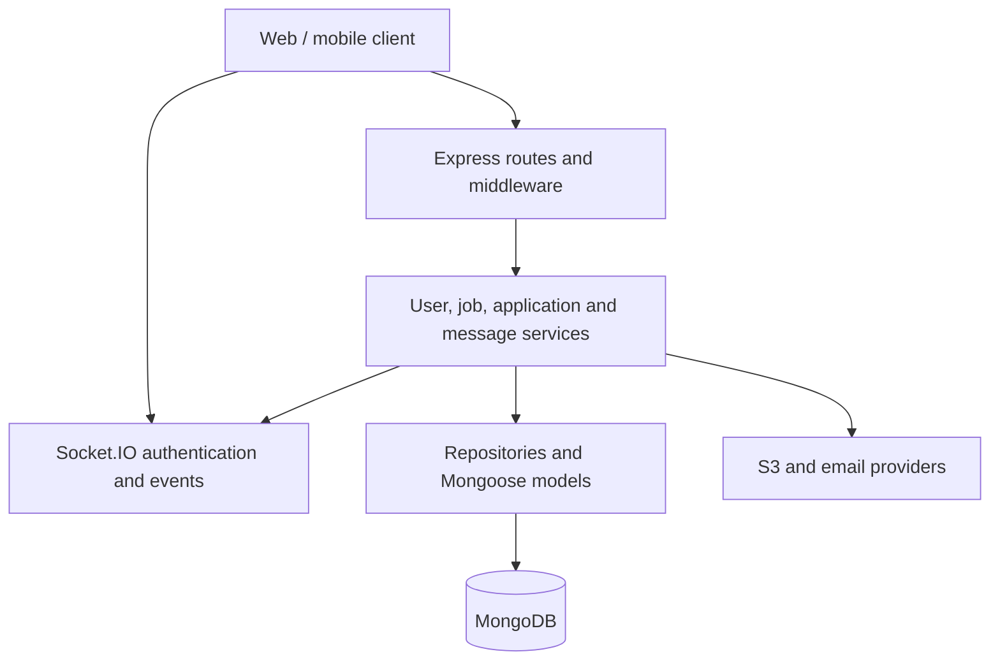

# Jobify — Recruitment Backend API

[](https://github.com/Mahetab21/jopify/actions/workflows/ci.yml)


A TypeScript backend for a recruitment platform connecting **job seekers** and **employers**. Jobify covers the journey from creating a professional profile to discovering jobs, submitting a resume, tracking an application, and messaging an employer.

This repository contains the **REST API and Socket.IO server** for a graduation project. A frontend and a hosted demo are not included.

[API reference](docs/API.md) · [Postman collection](docs/Jobify.postman_collection.json) · [Architecture](#architecture) · [Getting started](#getting-started)

## What it does

| Area | Implemented capabilities |
| --- | --- |
| Authentication | Email signup and confirmation, Google ID-token login, bcrypt password hashing, JWT access/refresh token issuance, current-session or all-session logout |
| Account recovery | Password reset with hashed, purpose-specific OTPs that expire after 10 minutes; confirmation-code resend |
| Professional profiles | Basic information, skills, experience, education, social links, resume upload and saved jobs |
| Job discovery | Keyword, location, category, employment type, experience, remote-work and salary filters; pagination and sorting |
| Employer workflows | Create and update owned jobs, optional company logo, soft/hard deletion, view applicants and update application status |
| Applications | Private resume upload, deadline checks, one application per job/user, withdrawal of pending applications and role-scoped statistics |
| Messaging | Persisted conversations, unread counts, read receipts, deletion per participant, online presence and typing events |
| API safeguards | Zod request validation, role and ownership checks, Helmet, rate limiting, configurable CORS and upload limits |

### Roles and permissions

| Role | Typical access |
| --- | --- |
| Guest | View active public jobs; register, confirm email and sign in |
| Job seeker | Manage a profile, save jobs, apply, view/withdraw own applications and message users |
| Employer | Manage own jobs, inspect their applications, change application status and message users |
| Admin | Administrative access to jobs and applications |

Public signup accepts only `job_seeker` and `employer`. Admins must be provisioned through a trusted database administration process. Profiles, saved jobs and messaging routes require authentication but are not restricted to one role.

## Technology

| Layer | Tools |
| --- | --- |
| Runtime and language | Node.js, TypeScript |
| HTTP API | Express 5 |
| Persistence | MongoDB, Mongoose, reusable repository classes |
| Authentication | JSON Web Tokens, bcrypt, Google Auth Library |
| Validation and security | Zod, Helmet, express-rate-limit, CORS |
| Files and email | Multer, AWS SDK for S3, Nodemailer with Gmail |
| Real-time transport | Socket.IO |
| Verification | Node.js test runner, isolated MongoDB via mongodb-memory-server, GitHub Actions |

## Architecture

Each feature separates route registration, request schemas and business logic. Repositories wrap Mongoose operations, while shared utilities handle tokens, hashing and storage.



| Directory | Responsibility |
| --- | --- |
| `src/config/` | Environment loading, startup checks and allowed origins |
| `src/DB/model/` | Users, jobs, applications, messages and revoked tokens |
| `src/DB/repositories/` | Shared CRUD/pagination and entity-specific persistence |
| `src/modules/user/` | Authentication, profiles and saved jobs |
| `src/modules/job/` | Job publishing and discovery |
| `src/modules/JobApplications/` | Application lifecycle and statistics |
| `src/modules/message/` | Conversations, messages and read status |
| `src/middleware/` | Authentication, authorization, validation, uploads and errors |
| `src/socket/` | Socket authentication, presence and typing events |
| `src/service/`, `src/utils/` | Email, storage, tokens and shared helpers |
| `tests/` | API and Socket.IO regression tests |
| `docs/` | Endpoint reference and Postman collection |

The application collection has a compound unique index on `jobId + userId`. Jobs embed a company snapshot and reference their posting user; there is no separate company-management module.

## Getting started

### 1. Install

Use **Node.js 22** and a local MongoDB instance or your own MongoDB Atlas database.

```bash
git clone https://github.com/Mahetab21/jopify.git
cd jopify
npm ci
```

### 2. Configure

Copy the example to `config/.env`:

```powershell
# Windows PowerShell
Copy-Item config/.env.example config/.env
```

```bash
# macOS / Linux
cp config/.env.example config/.env
```

Generate a different secret for each of the four JWT variables:

```bash
node -e "console.log(require('node:crypto').randomBytes(48).toString('hex'))"
```

| Variable | Purpose |
| --- | --- |
| `DB_URL` | MongoDB URI; example uses a local `jobify` database |
| `ACCESS_TOKEN_USER`, `ACCESS_TOKEN_ADMIN` | Distinct access-token signing secrets, at least 32 characters |
| `REFRESH_TOKEN_USER`, `REFRESH_TOKEN_ADMIN` | Two additional distinct refresh-token signing secrets |
| `PORT` | HTTP and Socket.IO port; defaults to `5000` |
| `SALT_ROUND` | bcrypt cost; defaults to `12`, supported range 10–15 |
| `FRONTEND_ORIGIN` | Comma-separated allowed browser origins |
| `BEARER_USER`, `BEARER_ADMIN` | Authorization prefix; keep both as `Bearer` for the examples |
| `EMAIL_USER`, `EMAIL_PASSWORD` | Gmail address and app password for confirmation/reset emails |
| `WEB_CLIENT_ID` | Google OAuth client ID, required only for Google login |
| `AWS_REGION`, `AWS_BUCKET_NAME` | S3 region and bucket, required for file uploads |
| `AWS_ACCESS_KEY_ID`, `AWS_SECRET_ACCESS_KEY` | Credentials for the configured S3 bucket |
| `APPLICATION_NAME` | Object-key prefix; example uses `jobify` |

Email and S3 are not needed to boot the API or browse jobs. They are required for their respective workflows. Keep the S3 bucket private, enable Block Public Access, and grant the application only the object permissions it needs. Standard uploads omit object ACLs so they work with Bucket owner enforced ownership.

### 3. Run

```bash
npm run build
npm start
```

For development, run `npm run start:dev` instead. It performs an initial build before starting the compiler watcher and Nodemon.

Open [http://localhost:5000](http://localhost:5000). Startup waits for MongoDB and fails if core configuration or the database connection is unavailable.

### 4. Try a workflow

1. Import [the Postman collection](docs/Jobify.postman_collection.json).
2. Set `baseUrl`, `seekerEmail`, `employerEmail` and a test `password` in its variables.
3. Register each account. Copy the emailed code into `otp` and send the matching confirmation request.
4. Sign in with each account. The collection saves `seekerToken` and `employerToken` automatically.
5. Create a job as the employer; its ID is saved to `jobId`.
6. Browse jobs, save one, and select a local PDF/DOC/DOCX in the application's `resume` file field before submitting.
7. Inspect applications as the employer and update their status. The apply request saves `appId`.
8. Set `receiverId` to another user's ID, send a message and connect a Socket.IO client to receive live events.

Request bodies are included as examples. See [the API reference](docs/API.md) for validation rules. Admin requests need a separately provisioned account and `adminToken`. The collection does not create admin accounts.

Use `Authorization: Bearer <access_token>` for protected routes. Existing route spellings such as `addExperiance` are preserved for client compatibility.

## Development and verification

| Command | Action |
| --- | --- |
| `npm run build` | Compile TypeScript into `dist/` |
| `npm run typecheck` | Check types without emitting files |
| `npm test` | Build and run API/Socket.IO integration tests |
| `npm run check` | Typecheck, build and run tests |
| `npm run start:dev` | Build once, then watch and restart |

Tests use a **temporary MongoDB instance and synthetic credentials**. External email delivery and S3 are stubbed, so no messages are sent and no real files are uploaded. A separate offline test verifies email composition through Nodemailer's stream transport. The first test run may download a MongoDB binary and needs internet access. CI runs these checks and a dependency audit on pushes to `main` and pull requests.

Coverage includes role escalation prevention, credential redaction, OTP confirmation/expiry, job ownership, public draft visibility, query parsing, duplicate applications, employer statistics, token revocation, multi-connection socket presence and message delivery/unread status. Tests do not verify live Google, Gmail or AWS accounts.

## Current boundaries and next steps

- Refresh tokens are issued, but a refresh/exchange endpoint and rotation workflow are not implemented.
- Upload endpoints return S3 object keys. A protected download endpoint for private files is a next step; the signing helper exists internally.
- Socket presence is in memory for a single server. A shared adapter/store is needed for multiple instances. Revocation is checked at connection time; existing connections need explicit invalidation for immediate logout.
- Application writes, counters and storage cleanup are not a distributed transaction. Failure recovery, concurrent withdrawal handling and orphan cleanup need further work.
- Further production hardening includes per-account OTP attempt limits, file-content verification and managed email retries.

## Security

Live credentials belong only in local environment files or your deployment's secret store. See [security and credential rotation notes](SECURITY.md), including the required owner actions for previously committed environment data.

## Maintainer

Maintained by **Mahitab Ayman** — [GitHub](https://github.com/Mahetab21). See the repository's [contributors and commit history](https://github.com/Mahetab21/jopify/graphs/contributors) for project contributions.

The repository URL intentionally remains `Mahetab21/jopify` so existing links continue to work.
